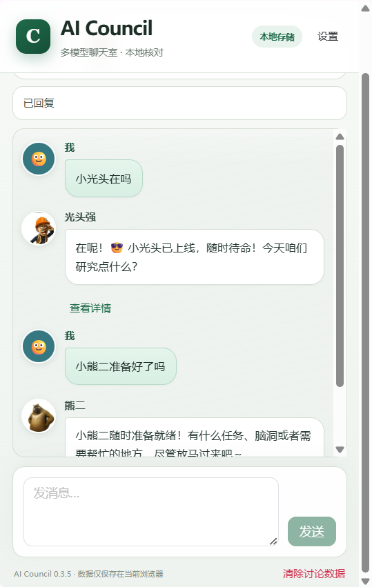
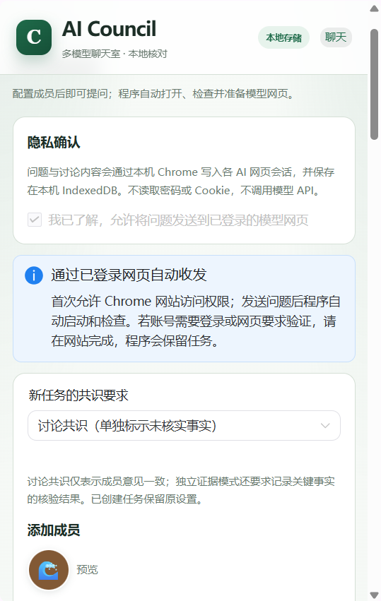
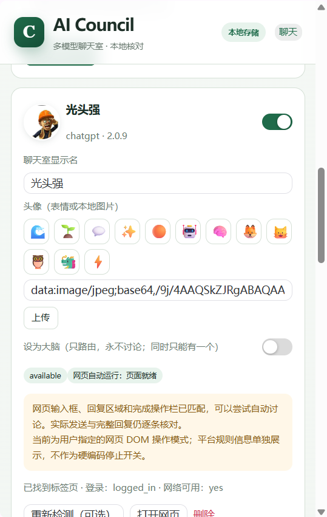

# AI Council

**把已登录的 AI 网页账号，组成一个本地多模型聊天室。**

AI Council 是一个 Chrome Manifest V3 扩展。你在侧边栏提出问题，它负责准备模型网页、发送消息、等待回复，并组织点名问答或多成员讨论。讨论可以包含交叉审查、争议处理与共识判断，最后生成可导出的报告。

**无需模型 API 或 API Key · 数据保存在本地 · 支持自定义成员名称与头像**

[下载 0.3.5](https://github.com/roesjack681/AI-council/releases/tag/v0.3.5) · [安装与使用](#安装与使用) · [开发与构建](#开发与构建) · [测试报告](docs/TEST-REPORT.md)

## 界面预览

以下为用户提供的 **0.3.5 实际界面截图**，展示点名聊天、设置与成员配置。

<table>
  <tr>
    <td align="center"><strong>多模型聊天室</strong></td>
    <td align="center"><strong>本地设置</strong></td>
    <td align="center"><strong>参与者配置</strong></td>
  </tr>
  <tr>
    <td></td>
    <td></td>
    <td></td>
  </tr>
</table>

## 可以做什么

| 功能         | 说明                                                                                             |
| ------------ | ------------------------------------------------------------------------------------------------ |
| 点名问答     | 给成员起名字，例如“光头强在吗”，将本次原话发给目标成员，直接展示自然语言回复。                   |
| 多模型讨论   | 多位成员独立作答、交叉审查、提出异议并修订结论。                                                 |
| 可选大脑路由 | 指定一个成员理解意图和分派任务；大脑不进入成员讨论或代替其他模型表态。                           |
| 自动准备网页 | 从聊天入口自动打开专用页面、检查输入框与登录状态、准备新聊天并等待加载。无需先手动发送测试消息。 |
| 共识与证据   | 可选择“讨论共识”或“独立证据”。模型意见一致和事实已经核实会分别记录。                             |
| 任务恢复     | 原始问题、消息队列、交付凭据、轮次和关键状态持久化；结果未知时先核对，避免盲目重发。             |
| 争议管理     | 结论有所有者、稳定标识与版本；重大争议不能凭一句同意关闭。                                       |
| 旧草稿保护   | 识别完整旧程序请求后先备份，再核对全文并移开；普通草稿仍保护。备份可以查看，恢复只填回输入框。   |
| 报告导出     | 导出 Markdown、HTML 和包含完整来源记录的 JSON。                                                  |

新问题会暂停旧题，记录保留。只有当前问题所属的请求可以继续派发，避免把旧任务的内容混进新聊天。

## 支持的平台与验证范围

| 平台     | 网页 DOM 适配器 | 无历史回答的首发回归 |
| -------- | --------------- | -------------------- |
| ChatGPT  | 已实现          | 已通过受控网页测试   |
| DeepSeek | 已实现          | 已通过受控网页测试   |
| Gemini   | 已实现          | 已通过受控网页测试   |
| 豆包     | 已实现          | 已通过受控网页测试   |

使用你自己的网页登录会话，不需要开通 Claude 或提供模型密钥。不同平台的账号、订阅及使用限制由各平台管理。

截图已展示点名聊天的实际回复。**四个平台真实账号的完整多轮讨论与无人值守共识流程，尚未全部验收**；受控网页测试通过不等于真实平台全流程已经通过。选择器会受页面更新、语言和账号布局影响。逐平台记录见 [平台验证报告](docs/PLATFORM-VERIFICATION.md)。

## 安装与使用

### 直接安装

1. 前往 [Releases](https://github.com/roesjack681/AI-council/releases/latest)，下载 `ai-council-0.3.5.zip`。
2. 解压安装包，确认目录内能看到 `manifest.json`。
3. 在 Chrome 打开 `chrome://extensions`，启用“开发者模式”。
4. 点击“加载已解压的扩展程序”，选择刚才的解压目录。
5. 点击 AI Council 图标，打开侧边栏；页脚应显示 **0.3.5**。

更新已有安装时，更新原来的扩展目录，再点击“重新加载”并重新打开侧边栏。保留原目录即可继续使用原有本地数据。

### 配置成员，然后直接聊天

1. 打开“设置”，阅读并确认隐私提示。
2. 添加成员：选择平台，填写显示名称；可使用表情或本地图片作为头像。
3. 首次允许 Chrome 对相应模型网站的访问权限。
4. 返回聊天室，直接输入问题。程序会自动打开、检查并准备专用网页。
5. 若网站要求登录或验证码，在网站完成相应步骤。任务记录会保留。

一名讨论成员即可接受点名提问；共识讨论需要至少两名讨论成员。大脑是可选的独立路由角色，不计入讨论成员人数。

你可以这样开始：

```text
光头强在吗

请两位成员独立分析这个方案，再互相检查遗漏与风险。
```

模型生成回复后，系统会核对请求标记、回复位置、完成控件及文本稳定状态，确认后才把回复交给后续流程。

## 数据与运行方式

- 扩展使用本地 IndexedDB，保存成员配置、问题、讨论消息、队列、争议、证据、报告和恢复副本。
- 问题与必要上下文会写入你选择的模型网页，因此仍会交给相应平台处理。
- 不读取账号密码或 Cookie，不调用模型 API，也不调用平台的私有网络接口。
- 每个任务使用有归属的专用标签页；只复用符合条件的已结束会话。
- 侧边栏打开时约每 3 秒推进一次短调度；关闭侧边栏后由约 30 秒一次的浏览器 alarm 继续推进。
- 浏览器、电脑、网络及网页登录会话需要保持可用。未实现电脑关闭后的云端运行。
- 未登录、验证码、权限缺失、草稿冲突、页面结构无法匹配或超时会保存状态并明确说明原因，不伪造回复或完成结果。

“重新检测”用于可选诊断，正常聊天无需先点击它。网页 DOM 就绪也不表示平台官方已经授权该自动化用途。

## 开发与构建

使用 Node.js **22.12+** 和 npm。在项目目录执行：

```bash
npm ci
npm run build
```

在 Chrome 中加载生成的 `dist/` 目录。修改源码后，需要重新构建并重新加载扩展。

| 命令                       | 用途                                                                               |
| -------------------------- | ---------------------------------------------------------------------------------- |
| `npm run dev`              | 启动界面预览，访问终端地址下的 `/sidepanel.html`。预览不具备 Chrome 网页执行能力。 |
| `npm run typecheck`        | TypeScript 严格类型检查。                                                          |
| `npm run test:coverage`    | 单元/集成测试和 V8 覆盖率。                                                        |
| `npm run check:compliance` | 检查扩展权限、模型 API/账号能力边界与测试数据打包边界。                            |
| `npm run test:e2e`         | 使用临时浏览器配置运行受控网页端到端测试。                                         |
| `npm run verify`           | 构建、核心覆盖、静态检查和浏览器测试。                                             |
| `npm run package`          | 生成扩展 ZIP、完整源码 ZIP 和 SHA-256 文件。                                       |

首次运行浏览器测试前，安装测试浏览器：

```bash
npx playwright install chromium
```

浏览器回归当前主要在 Windows 环境执行；不同系统需要适配相关临时目录路径检查。

## 技术结构

```text
src/
├── sidepanel/     # Vue 侧边栏、聊天室、设置和可恢复草稿界面
├── stores/        # Pinia 界面状态
├── services/      # 命令入口、成员服务、大脑请求队列、网站授权
├── core/          # 讨论、争议、共识、事实核验和请求归属
├── adapters/      # 平台配置、网页 DOM 读写、会话准备与草稿恢复
├── background/    # MV3 后台、浏览器端口、调度与状态恢复
├── database/      # Dexie / IndexedDB
├── protocols/     # TypeScript 类型和 Zod 输入协议
└── reports/       # Markdown / HTML / JSON 报告
```

技术栈：TypeScript 严格模式、Vue 3、Pinia、Naive UI、Dexie、Zod、Vite、Vitest、Playwright。

## 测试状态

最近一次 0.3.5 验证记录：

| 检查                           | 结果                              |
| ------------------------------ | --------------------------------- |
| 严格类型检查与生产构建         | 通过                              |
| 单元/集成                      | **166 项通过**                    |
| 浏览器场景                     | **34 项通过**                     |
| 权限与 API 边界静态检查        | 通过                              |
| V8 语句 / 分支 / 函数 / 行覆盖 | 88.82% / 82.70% / 91.73% / 90.26% |

测试回复只存在于测试目录，不会作为真实模型回答进入发布版。覆盖率口径、端到端测试边界和原始结果见 [测试报告](docs/TEST-REPORT.md)。

## 文档

- [架构与数据结构](docs/ARCHITECTURE.md)
- [完整目录](docs/DIRECTORY.md)
- [已实现功能与限制](docs/FEATURES.md)
- [平台验证报告](docs/PLATFORM-VERIFICATION.md)
- [测试报告](docs/TEST-REPORT.md)
- [开发决策与修复记录](docs/IMPLEMENTATION.md)
- [版本演进与早期安装记录](docs/CHANGELOG.md)

项目仍在迭代。反馈问题时，附上扩展版本、平台、报错代码与必要的页面诊断，可以更快定位问题。
